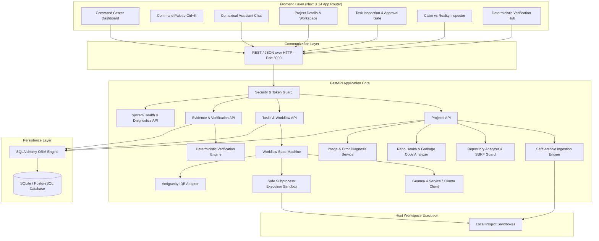

# VIKASA — System Architecture & Component Specification

---

## 1. High-Level Architecture Overview

---

## 2. Core Service Responsibilities

### 2.1 Project Analyzer Service (`backend/app/services/project_analyzer.py`)
- **SSRF Guard:** Validates remote Git URLs against blocked CIDRs (loopback, RFC 1918, link-local, AWS metadata).
- **Path Containment:** Ensures all repository inspection operations stay bounded within root workspace.
- **Tech Stack Detector:** Extracts dependencies, package managers, and runtime tools from manifests.
- **Architecture Graph Generator:** Builds nodes and edges describing modules, services, databases, and entrypoints.
- **Documentation Generator:** Synthesizes structured markdown documentation, API specifications, and setup instructions.

### 2.2 Deterministic Verification Engine (`backend/app/services/verification_engine.py`)
- **Authority Invariant:** AI claims are evaluated as hypotheses. Final verdict is strictly determined by:
  1. Process exit code (`code == 0` for pass).
  2. Non-empty Git diff (proving code actually changed).
  3. Acceptance criteria satisfaction coverage.
  4. Absence of contradictory error patterns (AssertionError, Traceback, SyntaxError).
- **Supported Verdicts:**
  - `VERIFIED` / `PASS`: All assertions, exit codes, and diff requirements satisfied.
  - `FAILED` / `FAIL`: Test failure, non-zero exit code, or contradictory error in logs.
  - `REVIEW_REQUIRED` / `UNKNOWN`: Ambiguous telemetry or missing diff.
  - `BLOCKED`: Missing dependencies or environment barriers.
  - `NOT_RUN`: Command was never scheduled or executed.

### 2.3 Safe Subprocess Runner (`backend/app/services/safe_runner.py`)
- Strictly sandboxed subprocess execution.
- Executable whitelist: `python`, `pytest`, `git`.
- Rejects shell metacharacters (`&`, `|`, `;`, `>`, `<`, `$`, `` ` ``).
- Enforces strict execution timeout (default: 30 seconds).
- Terminates entire process tree on timeout via OS-level signals.
- Scrubs sensitive environment variables (`AWS_SECRET_ACCESS_KEY`, `GITHUB_TOKEN`, `DATABASE_URL`).
- Redacts sensitive credentials in output streams.

### 2.4 Gemma 4 AI Service (`backend/app/services/gemma_service.py`)
- Connects to local Ollama instance (`http://localhost:11434`) running `gemma4:e4b`.
- Produces structured JSON task plans and failure diagnoses.
- Automatic deterministic fallback engine generates structured responses when Ollama is unavailable.
- Reports status truthfully: `AI_ACTIVE`, `FALLBACK_ACTIVE`, or `AI_UNAVAILABLE`.

### 2.5 Relational Persistence (`backend/app/models/`)
- Relational schema with foreign key relationships, timestamps, and indexes.
- Database agnostic: tested with SQLite for local development and compatible with PostgreSQL for production deployments.
