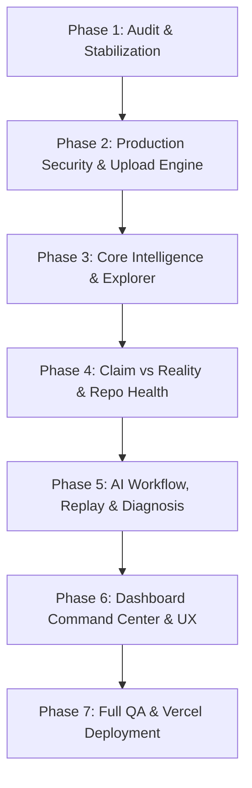

# VIKASA — Master Implementation Plan

**Version:** 1.0.0  
**Target:** Local Execution & Vercel Deployment  
**Lead Architect:** Principal AI & Systems Engineer  

---

## 1. Architectural Principles

1. **Deterministic Verification Authority:**
   - An LLM or AI agent must never mark a task verified or tests passed without verifiable empirical evidence (exit code 0, matching diff, non-empty stdout/stderr test report).
2. **Human in the Loop:**
   - Privileged operations (code execution, destructive cleanup, task execution) require explicit human approval.
3. **Defense in Depth:**
   - Strict SSRF blocking, path containment (`realpath`), binary allowlisting, process timeout termination, environment variable sanitization, and output credential redaction.
4. **Resilient Transparency:**
   - AI status clearly designated: `AI_ACTIVE` (Ollama/Cloud), `FALLBACK_ACTIVE` (deterministic rule generator), or `AI_UNAVAILABLE`.

---

## 2. Phase-by-Phase Execution Roadmap

### Phase 1: Audit & Stabilization (Completed)
- Established test baseline (233/233 passing backend tests).
- Verified Next.js 14 production build (16/16 routes compiled).
- Documented baseline audit report in `docs/IMPLEMENTATION_AUDIT.md`.
- Stabilized DNS fallback resolution in `ProjectAnalyzerService`.

### Phase 2: Production Foundations & Ingestion Engine
- **Task 2.1:** Implement Project Archive & Document Upload (`POST /api/projects/upload`):
  - Support `.zip`, `.tar.gz`, `.json`, `.yaml`, `.md`, `.py`, `.ts`, `.tsx`, `.js`.
  - Enforce zip-slip protection (prevent extraction escaping target sandbox directory).
  - Quota: 50MB max archive, 500 files max, 256KB per file inspection.
  - Secret filtering: skip `.env`, `.pem`, `.key`, `id_rsa`, `node_modules`, `venv`.
- **Task 2.2:** Server-side Token & Auth Guard:
  - Header validation (`X-VIKASA-KEY` or Bearer Token) with optional dev bypass.
  - Ownership association on project creation.
  - Subprocess execution gating in production mode.

### Phase 3: Core Intelligence & Repository Explorer
- **Task 3.1:** Repository File Tree & Content Explorer:
  - `GET /api/projects/{id}/files`: Bounded directory tree hierarchy.
  - `GET /api/projects/{id}/file-content`: Safe, contained file viewer with syntax highlighting support.
- **Task 3.2:** Enhanced Project Intelligence Analysis:
  - API endpoint catalog extraction (FastAPI, Express, Next.js routes).
  - Database schema & entity model detector.
  - Testing framework detector & test suite catalog.
  - Security risk detection (exposed credentials, CORS wildcards, missing auth).

### Phase 4: Verification Intelligence & Repository Health
- **Task 4.1:** Enhanced Claim vs Reality Engine:
  - 4-state verdicts: `Supported`, `Partially Supported`, `Contradicted`, `Unverified`.
  - Evidence linkage: exact file path, symbol, line range, and test outcome.
- **Task 4.2:** Repository Health & Garbage Code Analyzer:
  - `GET /api/projects/{id}/health-audit`: Detects dead code, unused dependencies, debugging statements (`console.log`, `print()`), and TODO markers.
  - `POST /api/projects/{id}/cleanup-proposal`: Generates human-reviewable diff proposal.

### Phase 5: AI Workflow, Replay & Visual Diagnosis
- **Task 5.1:** Project-Grounded AI Assistant:
  - `POST /api/projects/{id}/chat`: Context-aware Q&A using extracted project documentation, architecture, and tech stack.
- **Task 5.2:** Image-Based Issue Diagnosis:
  - `POST /api/projects/{id}/diagnose-image`: Accepts terminal errors or screenshot reports, extracts error signature, and maps to repository files.
- **Task 5.3:** Replay Mode & Event Timeline:
  - `GET /api/projects/{id}/replay/{timestamp}`: Reconstructs state at historical event points.

### Phase 6: Dashboard Command Center & UX Polish
- **Task 6.1:** Comprehensive Project Navigation:
  - Add dedicated sub-views in `frontend/app/projects/[projectId]/page.tsx`:
    - Overview, Features Checklist, Tasks, Architecture, Explorer, API Docs, Verification, Security, Claim vs Reality, AI Chat, Replay, Cleanup, Image Diagnosis.
- **Task 6.2:** Global Command Palette (`Ctrl+K`):
  - Instant navigation across projects, tasks, and verification runs.
- **Task 6.3:** Report & Architecture Exporters:
  - Export Markdown project audit, Mermaid architecture diagrams, and JSON evidence reports.

### Phase 7: Deployment & Final QA
- Test all backend endpoints with pytest.
- Test frontend production build.
- Document Vercel Next.js configuration and backend deployment options.
